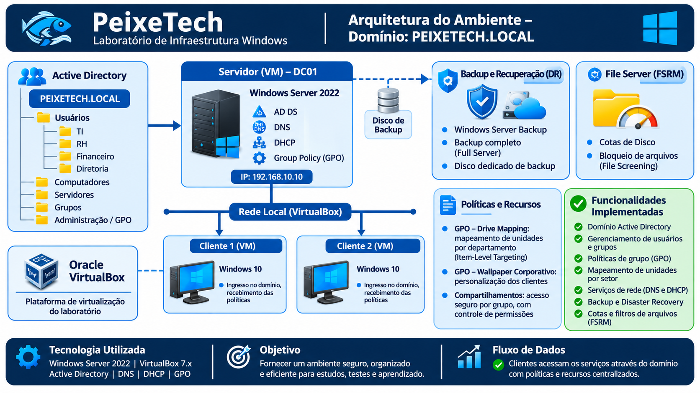

# PeixeTech — Laboratório de Infraestrutura Windows
Laboratório prático de administração de sistemas e infraestrutura corporativa.

## Sobre o projeto
O PeixeTech é um laboratório de infraestrutura de TI desenvolvido em ambiente virtualizado com Oracle VirtualBox e Windows Server 2022.
O projeto simula a infraestrutura tecnológica de uma pequena empresa, utilizando serviços centralizados para gerenciamento de usuários, computadores, autenticação, políticas de segurança, recursos de rede, governança de armazenamento e rotinas de disaster recovery.

---
## Arquitetura

## 🎯 Objetivos
- Implementar e administrar um domínio Active Directory.
- Gerenciar usuários, grupos e unidades organizacionais (OUs).
- Configurar serviços de resolução de nomes (DNS).
- Implementar distribuição automática de endereços IP (DHCP).
- Criar e administrar políticas de grupo (GPO).
- Automatizar o mapeamento de unidades de rede.
- Trabalhar com compartilhamentos e controle de permissões.
- **Configurar rotinas de Backup e Recuperação de Desastres (DR) com o Windows Server Backup.**
- **Implementar governança de armazenamento com FSRM (Cotas de Disco e Filtros de Arquivos).**
- Desenvolver habilidades de diagnóstico e troubleshooting.

---

## 💻 Tecnologias Utilizadas

| Tecnologia | Aplicação |
| :--- | :--- |
| **Windows Server 2022** | Servidor de infraestrutura |
| **Active Directory Domain Services** | Gerenciamento de domínio |
| **DNS** | Resolução de nomes |
| **DHCP** | Distribuição de endereços IP |
| **Group Policy Objects** | Gerenciamento centralizado de políticas |
| **Windows Server Backup** | Rotinas de backup e disaster recovery |
| **FSRM (File Server Resource Manager)** | Gestão de cotas e filtros de arquivos |
| **Windows 10** | Sistemas clientes |
| **Oracle VirtualBox** | Virtualização |

---

## 🏢 Ambiente do Laboratório

* **Domínio:** `PEIXETECH.LOCAL`
* **Servidor (`DC01`):** Controlador de domínio Windows Server 2022
* **Virtualização:** Oracle VirtualBox
* **Clientes:** Windows 10

---

## ⚙️ Funcionalidades Desenvolvidas
- Estrutura organizacional de Active Directory.
- Gerenciamento de usuários e grupos de segurança.
- Políticas de grupo para gerenciamento de recursos.
- Mapeamento automatizado de unidades de rede por departamento utilizando Item-Level Targeting.
- **Rotina automatizada de Backup Completo (*Full Server*) com disco dedicado.**
- **Governança de armazenamento avançada com Cotas de Disco e bloqueio de arquivos indesejados (*File Screening*).**

---

## 📂 Documentação
A documentação está organizada por áreas técnicas:
- `01-sistemas`: preparação e configuração do servidor.
- `02-active-directory`: instalação e administração do AD DS.
- `03-dns`: configuração e validação do DNS.
- `04-dhcp`: configuração e administração do DHCP.
- `05-usuarios-grupos`: gerenciamento de usuários e grupos.
- `06-gpo`: criação e administração de políticas de grupo.
- `07-clientes`: integração e validação das máquinas clientes.
- `08-backup-e-recuperacao`: configuração de Disaster Recovery e Windows Server Backup.
- `09-file-server-avancado`: implementação de Cotas e Filtros de Arquivos via FSRM.

---
Projeto desenvolvido para fins de estudo prático e desenvolvimento profissional em Administração de Sistemas e Infraestrutura de TI.
