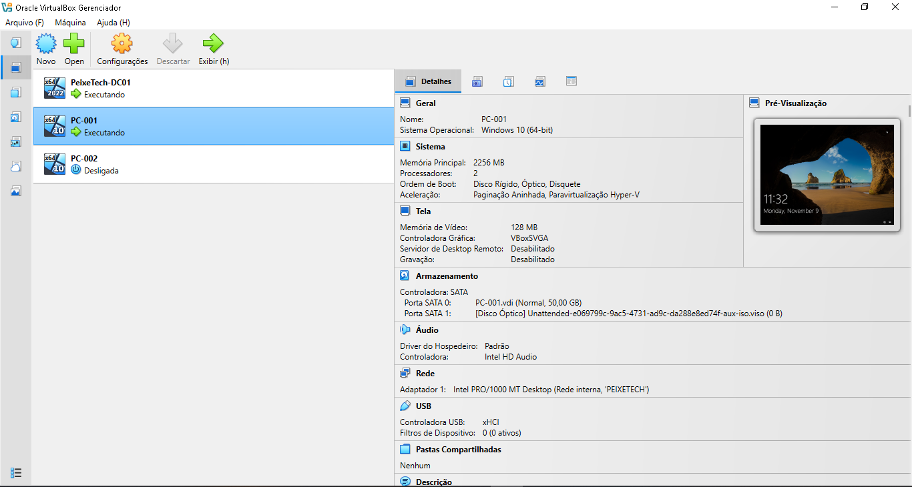

# 01 - Sistemas e Ambiente de Virtualização

Esta pasta documenta a infraestrutura base do laboratório **PeixeTech**, simulando um ambiente corporativo real baseado em tecnologias Microsoft Windows Server.

## 🛠️ Especificações do Ambiente

* **Hipervisor / Virtualização:** Oracle VirtualBox
* **Controlador de Domínio (DC):** Windows Server 2022 (Hostname: `DC01`)
* **Serviços de Diretório:** Active Directory Domain Services (AD DS)
* **Estações Clientes:** Windows 10 integradas ao domínio `PEIXETECH.LOCAL`

## 📸 Evidência da Infraestrutura

## 📋 Objetivos Técnicos da Camada de Sistemas
* Implantação e subida de um controlador de domínio do zero.
* Integração e testes de comunicação entre máquinas clientes e servidor em ambiente isolado.
* Padronização do ambiente virtual para aplicação centralizada de serviços de rede (DNS/DHCP) e políticas de grupo (GPOs).
