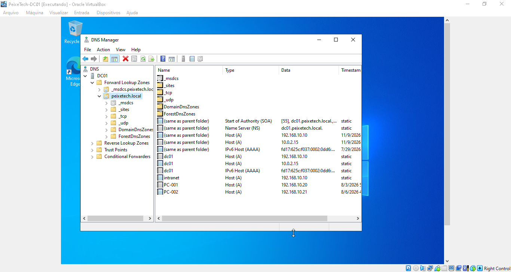

# 03 - Serviço DNS (Domain Name System)

Esta pasta documenta a configuração e validação do serviço de DNS no Controlador de Domínio (`DC01`) do laboratório **PeixeTech**, garantindo a correta resolução de nomes para o domínio `PEIXETECH.LOCAL`.

## 🌐 Informações e Configurações
* **Servidor DNS:** `DC01` (`peixetech.local`)
* **Tipo de Zona:** Integrada ao Active Directory (Active Directory-integrated zone)

## 📸 Evidência do Console DNS (Forward Lookup Zones)

Abaixo está o print evidenciando a zona de pesquisa direta configurada com os registros de hosts e controladores do domínio:

## 📋 Justificativa Técnica
* **Integração com AD DS:** As zonas integradas garantem segurança e replicação automática dos registros de recursos dentro da floresta.
* **Resolução de Nomes:** Permite que clientes e servidores localizem controladores de domínio de forma transparente através de registros SRV e A.
