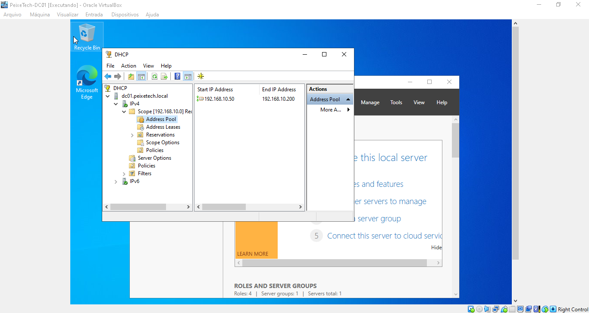

# 04 - Serviço DHCP (Dynamic Host Configuration Protocol)

Esta pasta documenta a implementação, o escopo e as evidências do servidor DHCP no laboratório **PeixeTech**, responsável pela distribuição automatizada de endereços IP, máscara de sub-rede, gateway padrão e servidores DNS para as máquinas clientes do domínio `PEIXETECH.LOCAL`.

## 🌐 Parâmetros do Escopo DHCP
* **Nome do Escopo:** `Rede-PeixeTech`
* **Faixa de IPs Distribuídos:** `192.168.10.50` até `192.168.10.200`
* **Máscara de Sub-rede:** `255.255.255.0` (`/24`)
* **Gateway Padrão:** `192.168.10.1`
* **Servidor DNS Primário:** `192.168.10.10` (`DC01`)

## 📸 Evidência do Pool de Endereços (DHCP Scope)

Abaixo está o print evidenciando o escopo ativo e o intervalo de IPs configurado no console de gerenciamento do DHCP:

## 📋 Justificativa Técnica
* **Automação de Rede:** Elimina a necessidade de configuração estática de endereços IP em estações de trabalho e clientes, agilizando o provisionamento no laboratório.
* **Integração com Active Directory:** O serviço foi autorizado no diretório para garantir a operação segura e coordenada com o serviço de nomes (DNS) e o domínio.
