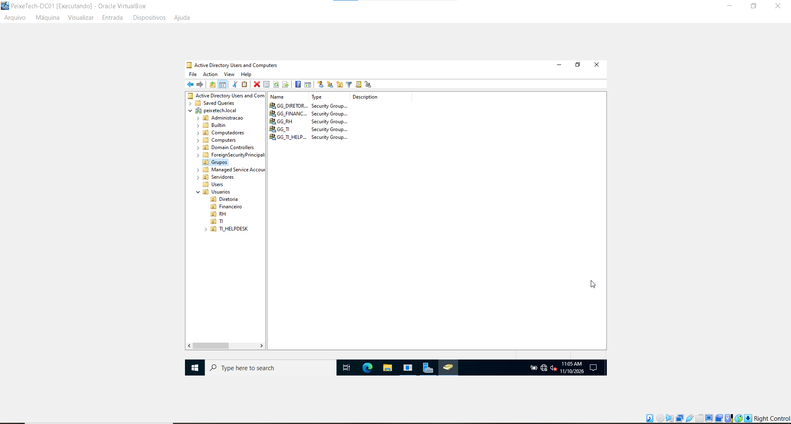
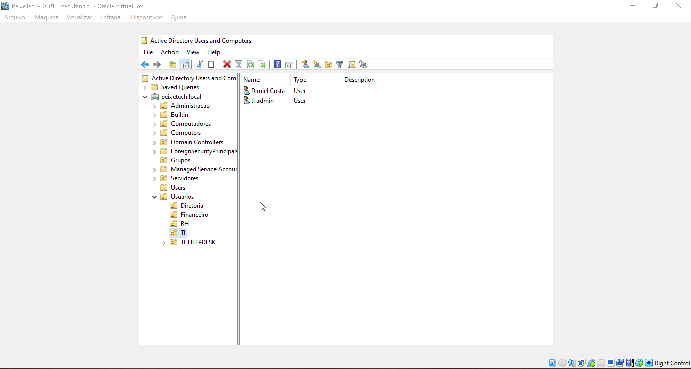

# 06 - Gestão de Usuários e Grupos (AD DS)

Esta pasta documenta o provisionamento de contas de usuários corporativos e a estruturação de grupos de segurança no laboratório **PeixeTech**, alinhados ao domínio `PEIXETECH.LOCAL`.

## 👥 Padrão de Nomenclatura (Naming Convention)
* **Usuários:** Identificação baseada no nome e sobrenome (ex: `Carlos Oliveira`, `Daniel Costa`).
* **Grupos de Segurança:** Prefixo `GG_` para Grupos Globais, seguidos pelo departamento (ex: `GG_TI`, `GG_DIRETORIA`).

## 📁 Organização nas Unidades Organizacionais (OUs)
* **OU `Usuarios/TI`**: Contém contas de colaboradores de tecnologia, como administradores de sistemas (`ti admin`) e suporte.
* **OU `Usuarios/Diretoria`**: Contém contas executivas com privilégios específicos e acesso a pastas confidenciais.
* **OU `Grupos`**: Concentra os grupos globais de segurança responsáveis pelo controle de acesso baseado em funções (RBAC).

## 📸 Evidências do Active Directory (ADUC)

### Visão Geral dos Grupos Globais

### Contas de Usuários na OU de TI

### Contas de Usuários na OU de DIRETORIA

## 📋 Justificativa Técnica
* **Controle Baseado em Funções (RBAC):** A aplicação de permissões a grupos de segurança em vez de usuários individuais simplifica a governança de acessos e auditorias de segurança.
* **Isolamento Departamental:** A separação lógica em OUs garante a aplicação direcionada de Políticas de Grupo (GPOs) específicas para cada setor.
