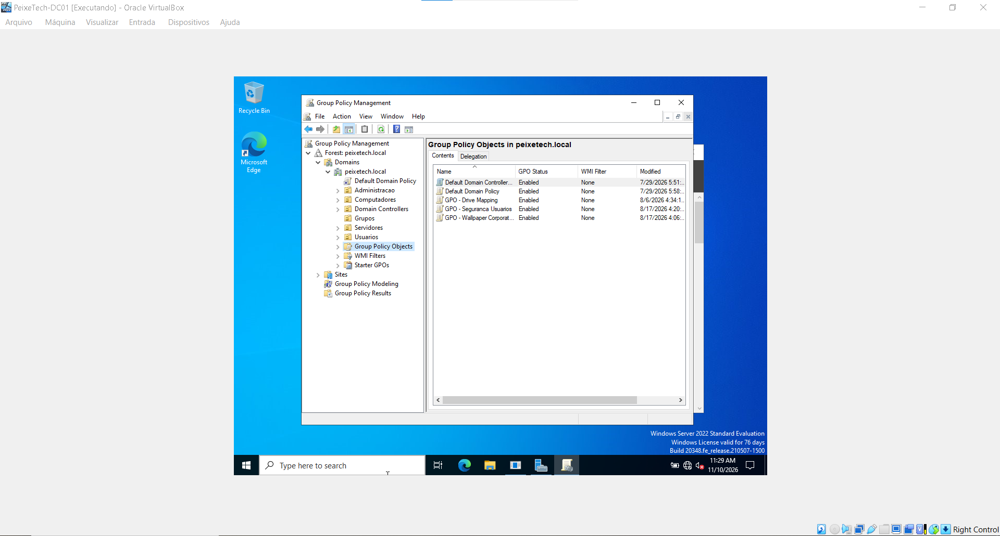
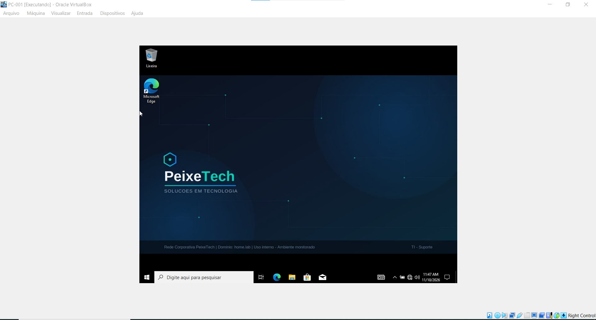
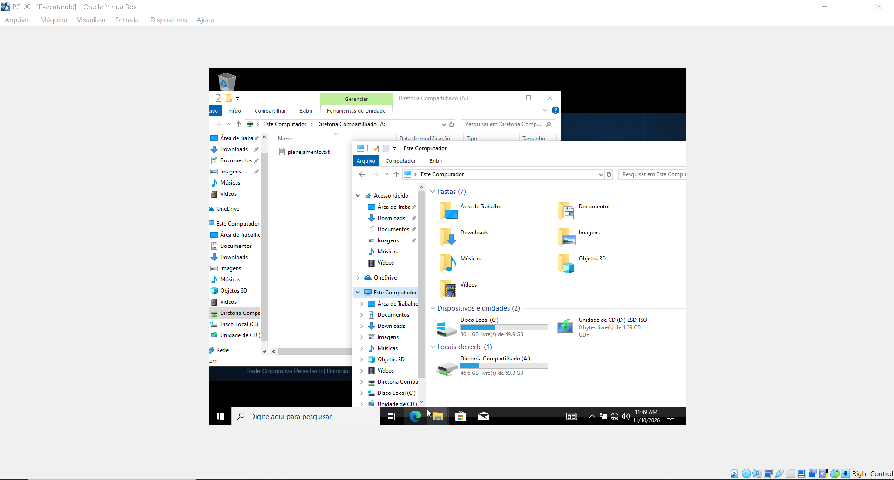

# 06 - Políticas de Grupo (GPO - Group Policy Object)

Esta pasta documenta a criação, o vínculo e a validação de Políticas de Grupo no laboratório **PeixeTech** (`PEIXETECH.LOCAL`), garantindo a automação de configurações, o isolamento de segurança e a personalização do ambiente de trabalho nas estações ingressadas no domínio.

## ⚙️ GPOs Implementadas e Escopo
1. **`GPO - Wallpaper Corporativo`**: Responsável por padronizar a área de trabalho dos computadores com a identidade visual institucional da PeixeTech.
2. **`GPO - Drive Mapping`**: Automatiza o mapeamento de unidades de rede departamentais (ex: `Diretoria Compartilhado (A:)`) diretamente na sessão do usuário no logon.
3. **`GPO - Seguranca Usuarios`**: Aplica diretrizes de controle de acesso, restrições e segurança nas estações de trabalho.

---

## 📸 Evidências Visuais e Validação

### 1. Console de Gerenciamento de GPO (GPMC)
Visão geral das políticas criadas e estruturadas no Controlador de Domínio (`DC01`):

### 2. Validação do Wallpaper Corporativo (Client-Side)
Estação de trabalho (`PC-001`) ingressada no domínio exibindo o papel de parede aplicado automaticamente via política de grupo:

### 3. Validação do Mapeamento de Unidade de Rede
Explorador de arquivos da máquina cliente demonstrando o acesso bem-sucedido à pasta compartilhada do departamento:

---

## 📋 Justificativa Técnica
* **Padronização e Governança:** O gerenciamento centralizado por GPO elimina a necessidade de configurações manuais máquina por máquina, assegurando conformidade com os padrões corporativos.
* **Experiência do Usuário (UX) Automatizada:** O mapeamento dinâmico de unidades de rede e a personalização de workspace garantem que o colaborador tenha acesso imediato aos seus recursos de trabalho assim que realiza o logon no domínio.
