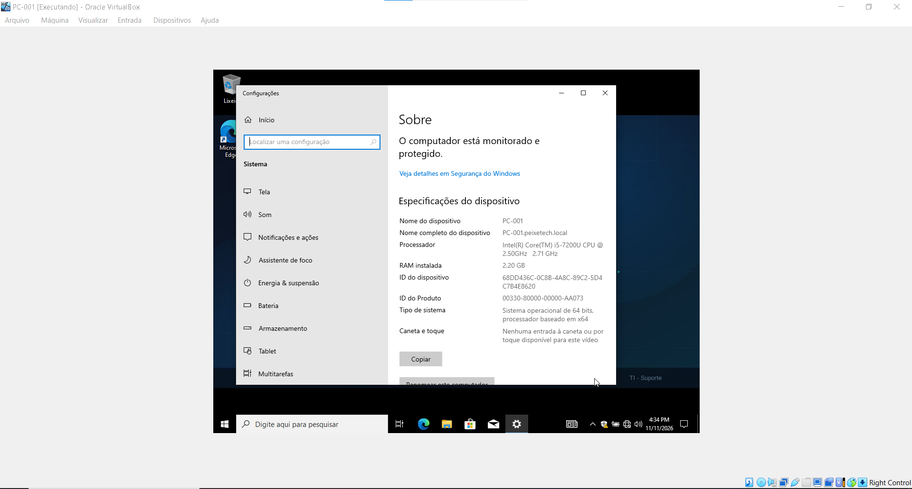

# 07 - Estações Clientes (Domain Join & Workstations)

Esta pasta documenta o processo de provisionamento, ingresso de estações de trabalho e validação de conectividade com o domínio no laboratório **PeixeTech** (`PEIXETECH.LOCAL`).

## 💻 Configurações das Estações
* **Nome do Computador de Teste:** `PC-001`
* **Sistema Operacional Cliente:** Windows 10 Pro
* **Método de Ingresso:** Associação direta ao Active Directory via credenciais administrativas do domínio.
* **Resolução de Nomes (DNS):** Aponte o DNS primário da placa de rede do cliente para o IP do `DC01` (`192.168.10.10`).

## 📸 Evidência de Ingresso no Domínio (Domain Join)

Abaixo está o print evidenciando que a máquina cliente está integrada com sucesso ao domínio corporativo, exibindo o nome do dispositivo e o sufixo DNS correspondente:

## 📋 Justificativa Técnica
* **Gestão Centralizada:** O ingresso de estações no Active Directory permite que o controle de políticas de segurança (GPOs), auditorias e inventário seja feito de forma unificada pelo setor de TI.
* **Autenticação de Rede:** Garante que os usuários corporativos façam logon em qualquer máquina da rede utilizando suas credenciais de domínio padronizadas, recebendo automaticamente os mapeamentos de rede e personalizações visuais.
