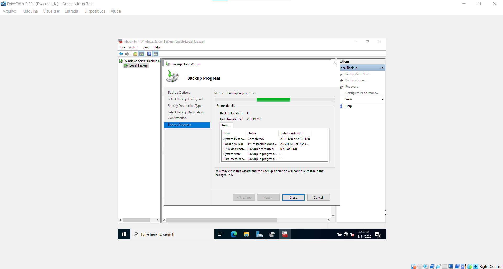

# Módulo 08: Backup e Recuperação de Desastres (DR) - PeixeTech

Este módulo documenta a implementação e o teste da rotina de Disaster Recovery utilizando o **Windows Server Backup** no controlador de domínio `DC01` (Windows Server 2022).

---

## 🛠️ Objetivos
- Configurar um segundo disco rígido virtual dedicado para armazenamento de backups.
- Implementar e executar uma rotina de Backup Completo (*Full Server Backup*).
- Validar logs, relatórios e status de sucesso do backup.

---

## 📋 Passo a Passo Executado

1. **Adição de Disco Virtual:**
   - Foi adicionado um disco rígido virtual de 20 GB na máquina virtual via VirtualBox.
   - O disco foi inicializado (GPT/MBR) e formatado como volume local no *Gerenciamento de Disco* (`diskmgmt.msc`).

2. **Configuração do Windows Server Backup:**
   - Instalação do recurso *Windows Server Backup* via Server Manager.
   - Abertura do console administrativo (`wbadmin.msc`).
   - Seleção da opção **Backup Once** com configuração personalizada (*Custom*) para o escopo **Full Server** (incluindo System State e volumes locais).
   - Definição do destino apontando para a unidade local dedicada.

---

## 📸 Evidências do Laboratório

### 1. Execução e Progresso do Backup
O assistente executando o backup completo em background na unidade de destino configurada:

### 2. Conclusão com Sucesso (*Successful*)
Painel principal do Windows Server Backup comprovando o status verde de sucesso (*Successful*) após a finalização da rotina:

