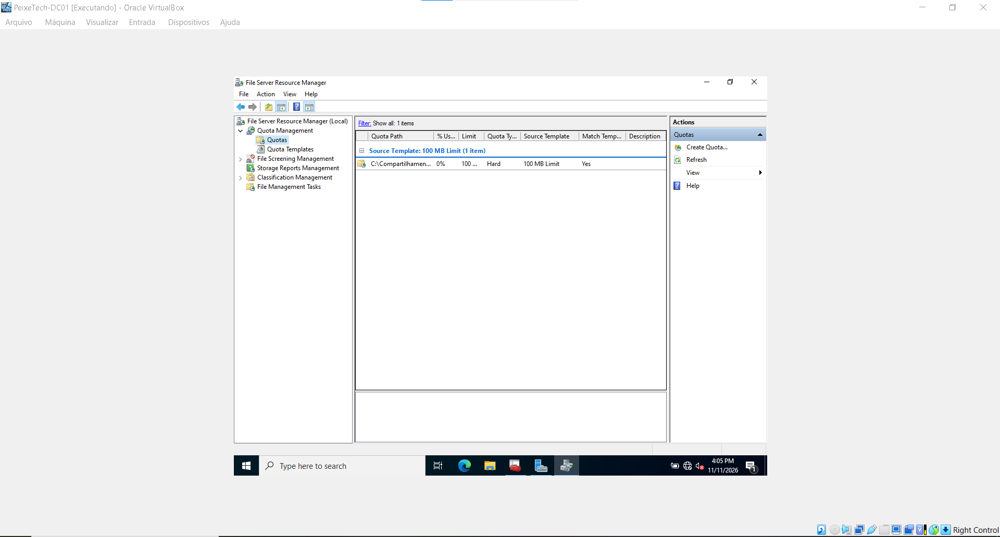
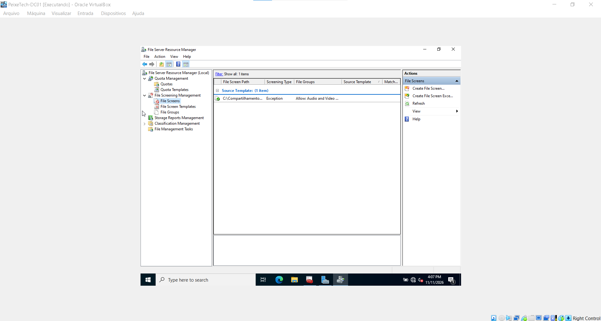

# Módulo 09: Gerenciamento Avançado de Servidor de Arquivos (FSRM) - PeixeTech

Este módulo documenta a implementação de políticas de governança e controle de armazenamento utilizando o **FSRM (File Server Resource Manager)** no servidor `DC01` (Windows Server 2022).

---

## 🛠️ Objetivos
- Instalar e configurar a função do FSRM no Windows Server.
- Implementar **Cotas de Disco (Quotas)** para limitar e monitorar o consumo de espaço em pastas compartilhadas.
- Configurar **Filtros de Arquivos (File Screening)** para bloquear tipos indesejados de arquivos (como áudio, vídeo e executáveis) nos diretórios corporativos.

---

## 📋 Passo a Passo Executado

1. **Instalação do FSRM:**
   - Adicionado o recurso *File Server Resource Manager* através do **Server Manager** (`Add Roles and Features` > *File and Storage Services*).

2. **Criação de Cotas de Disco:**
   - Configuração de um limite rígido (*Hard Quota*) de 100 MB baseado em templates pré-definidos para o diretório de departamentos e pastas compartilhadas.

3. **Filtros de Arquivos (File Screening):**
   - Criação de regras ativas de bloqueio para gerenciar extensões não autorizadas, garantindo a conformidade e a segurança do armazenamento.

---

## 📸 Evidências do Laboratório

### 1. Gerenciamento de Cotas (*Quotas*)
Painel do FSRM exibindo a cota aplicada com sucesso na pasta compartilhada (limite de 100 MB, tipo *Hard*):

### 2. Filtros de Arquivos (*File Screening*)
Painel do FSRM demonstrando a regra ativa configurada para o monitoramento e bloqueio de grupos de arquivos indesejados:

